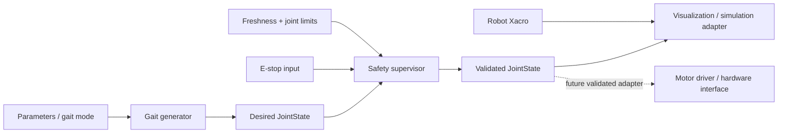

# QuadroX Robotics

**ROS 2 quadruped robotics software foundation** — modular gait generation, command validation, safety gating, robot description, tests, and integration documentation.


QuadroX is a simulation-first software foundation for a four-legged robot. It provides a configurable trot-style joint-space gait generator, a command safety gate, a parameterized robot description, launch/configuration files, and automated tests.

**Hardware-agnostic by design:** this repository does not assume a particular servo, motor driver, MCU, encoder, battery, or CAD geometry. The default output is a `sensor_msgs/msg/JointState` topic for visualization and integration work. A hardware adapter must be implemented and validated for the actual robot before commanding motors.

> **Safety:** This is a research prototype, not a certified safety controller. Start in simulation or with actuators physically disconnected. Software checks do not replace a physical power disconnect, current limiting, mechanical stops, or hardware-level emergency stop.

## Features

- ROS 2 Jazzy `ament_python` package
- 12-joint naming convention (3 joints per leg)
- Configurable stand and trot target generation
- Joint name/value/limit validation and stale-command timeout
- E-stop topic that latches software stop
- Neutral pose output while disabled or stopped
- Xacro robot description with placeholder geometry
- Launch file, YAML parameters, RViz configuration
- Pure Python unit tests and GitHub Actions CI
- Hardware integration checklist and validation plan

## Architecture



## Repository layout

```text
QuadroX-Robotics/
├── src/quadrox_control/      # ROS 2 nodes and pure control logic
├── launch/                   # launch entry points
├── config/                   # parameters and joint limits
├── description/              # Xacro robot model and RViz config
├── tests/                    # unit tests
├── hardware/                 # integration and safety checklist
├── docs/                     # architecture and validation plan
└── .github/workflows/        # CI
```

## Requirements

- ROS 2 Jazzy on Ubuntu 24.04
- Python 3.12
- `rclpy`, `sensor_msgs`, `std_msgs`, `launch`, `launch_ros`, `ament_index_python`, `xacro`

See the official [ROS 2 Jazzy documentation](https://docs.ros.org/en/jazzy/) and [ros2_control getting started guide](https://control.ros.org/jazzy/doc/getting_started/getting_started.html).

## Build and run

In a sourced ROS 2 Jazzy terminal:

```bash
sudo apt update
sudo apt install -y python3-colcon-common-extensions python3-rosdep python3-xacro
mkdir -p ~/quadrox_ws/src
cp -r QuadroX-Robotics ~/quadrox_ws/src/
cd ~/quadrox_ws
rosdep install --from-paths src --ignore-src -r -y
colcon build --symlink-install
source install/setup.bash
ros2 launch quadrox_control bringup.launch.py
```

Topics:
- `/quadrox/desired_joint_states` — generated targets
- `/quadrox/safe_joint_states` — output after the safety gate
- `/quadrox/estop` — `std_msgs/msg/Bool`; `true` latches software stop

Inspect the command stream:

```bash
ros2 topic echo /quadrox/safe_joint_states
ros2 topic pub --once /quadrox/estop std_msgs/msg/Bool "{data: true}"
```

The launch starts software nodes only; it does not start Gazebo physics or a motor driver. The Xacro model uses simplified placeholder geometry and is not dimensionally accurate to your physical robot.

## Operating modes

- `stand`: constant neutral joint pose
- `trot`: periodic diagonal-pair joint-space target approximation
- Safety gate: checks joint names, finite values, configured bounds, command freshness, and E-stop state

The safety supervisor starts disabled by default. This initial software version has no enable service; set `enabled_at_start: true` only for simulation/testing after inspecting the command stream. Never connect the topic directly to actuators.

## Hardware integration contract

Before connecting motors, implement and validate an adapter for the actual actuator protocol. It must include real joint limits, command timeout, communication fault handling, physical E-stop/power disconnect, feedback plausibility checks, bounded velocity/acceleration, and watchdog behavior. `ros2_control` may be appropriate once the hardware and interfaces are known.

## Tests

```bash
python3 -m pytest
```

In a sourced ROS 2 workspace:

```bash
colcon build --symlink-install
colcon test --event-handlers console_direct+
colcon test-result --verbose
```

## Add your CAD/STL

Place your own STL/CAD exports in `description/meshes/` or `mechanical/`. Update the Xacro model with verified link dimensions, masses, inertias, joint origins, axes, and limits. Large or proprietary CAD files are ignored by default; force-add only the files you intend to publish.

## Roadmap

- [ ] Add actual CAD/STL and measured link dimensions
- [ ] Verify joint axes, signs, zero offsets, and limits
- [ ] Add actuator/encoder BOM and electrical schematics
- [ ] Add measured joint-state feedback
- [ ] Integrate Gazebo simulation and validate the model
- [ ] Add hardware-specific driver / `ros2_control` interface
- [ ] Add IMU stabilization and terrain-aware foothold planning
- [ ] Validate gait stability, power draw, thermal behavior, and E-stop on a restrained test rig

## License

MIT. See `LICENSE`.
